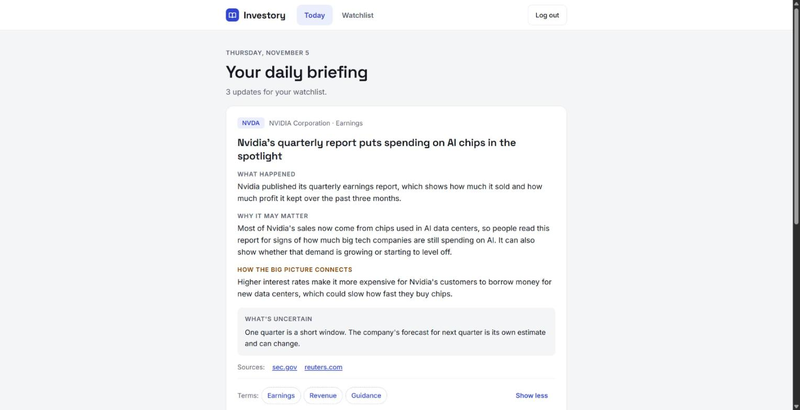
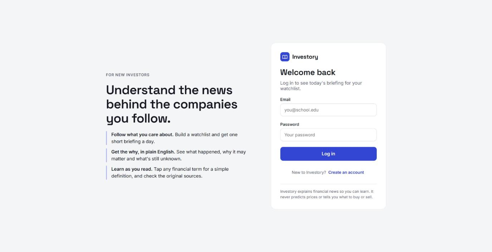
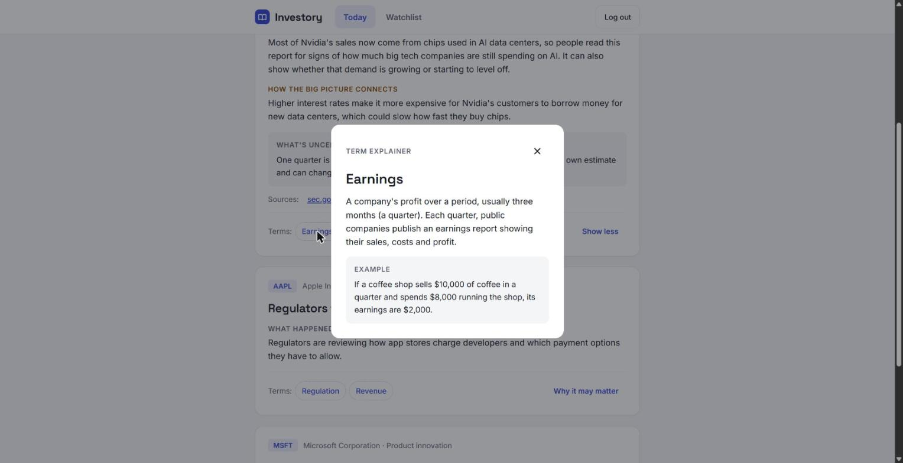
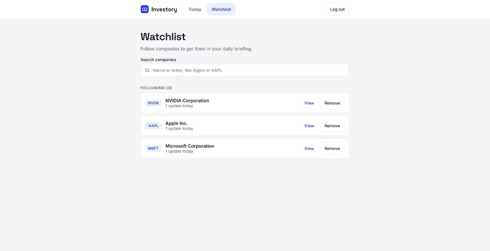
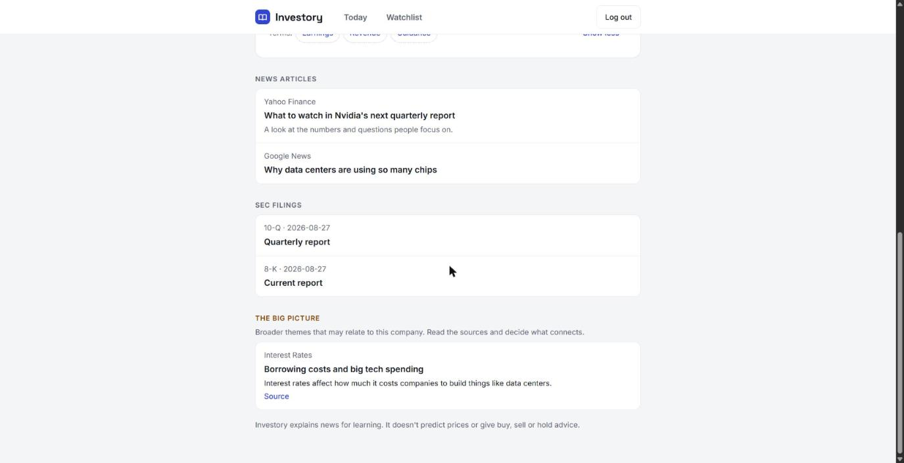

# Investory

**Understand the news behind the companies you follow.**

Investory helps college students and other beginner investors keep up with the companies they care about. You build a watchlist, and each day you get a short briefing that explains what happened, why it may matter and what's still unknown, in plain English and with links to the original sources.

Investory is an education tool. It never predicts prices or gives buy, sell or hold advice.



*Screenshots show sample stories, not real news.*

## Features

- **Daily briefing:** one short story card per update, with what happened, why it may matter, how the bigger picture connects and what's uncertain.
- **AI explanations:** Claude rewrites headlines for beginners. Without an API key, the app uses built-in text for each news category instead.
- **Term pop-ups:** tap a financial term for a simple definition and an example.
- **Watchlist:** search for companies and follow or remove them.
- **Company pages:** today's stories, recent news, SEC filings and related economic themes in one place.
- **Built-in guardrails:** the AI is told not to predict prices or give advice, and a safety check also strips advice-like phrases from what it writes.

| Log in | Term pop-up |
|---|---|
|  |  |

| Watchlist | Company page |
|---|---|
|  |  |

## How it works

```
Yahoo Finance + Google News feeds, SEC filings
        │
        ▼
FastAPI backend ── classifies stories, removes duplicates
        │          asks Claude for beginner explanations
        │          checks the text for advice language
        ▼
Supabase (Postgres + login) ◄──► React frontend
```

| Layer | Tools |
|---|---|
| Frontend | React, TypeScript, Vite |
| Backend | Python, FastAPI, SQLAlchemy |
| Database and login | Supabase |
| AI | Claude, through the official Anthropic SDK |

## Run it locally

You'll need Python 3.13, Node.js 22.12 or newer, and a free [Supabase](https://supabase.com) project.

### 1. Backend

```powershell
cd backend
python -m venv .venv
.\.venv\Scripts\Activate.ps1
pip install -r requirements.txt
copy .env.example .env
```

Fill in `backend/.env` with your Supabase details. See [docs/AUTH_SETUP.md](docs/AUTH_SETUP.md) for where to find them. Then create the tables and start the API:

```powershell
$env:PYTHONPATH = (Get-Location).Path
python db\apply_migrations.py
uvicorn app.main:app --reload
```

Check http://127.0.0.1:8000/health. It should report `"status": "ok"`.

### 2. Frontend

```powershell
cd frontend
npm install
copy .env.example .env
npm run dev
```

Fill in `frontend/.env`, then open http://localhost:5173 and create an account.

### 3. Turn on AI explanations (optional)

Add an [Anthropic API key](https://platform.claude.com/settings/keys) to `backend/.env` and restart the API:

```env
ANTHROPIC_API_KEY=your-key-here
```

`/health` will then report `"ai_explanations": true`. Each new story uses one API call, and repeated stories are cached while the server is running.

### Daily news

With `ENABLE_DAILY_SCHEDULER=true`, the API refreshes briefings once a day while it's running, at the hour set by `DAILY_INGEST_HOUR_UTC`. You can also click **Build today's briefing** in the app, or have a scheduled job call `POST /internal/jobs/daily-ingest` with an `X-Job-Secret` header.

### Tests

```powershell
cd backend
python -m unittest discover tests
```

## Project layout

```
backend/    FastAPI app, database migrations and tests
frontend/   React app
docs/       API contract, login setup and screenshots
```

The full list of API routes is in [docs/API_CONTRACT.md](docs/API_CONTRACT.md).

## Current limits

- Company search covers 12 starter companies, listed in [`003_seed_companies.sql`](backend/db/migrations/003_seed_companies.sql).
- There's no stock price data, by design for now.
- It runs locally and hasn't been deployed yet.

## Credits

Started by Ethan Tandio and Aiden Loza in Builder Cohort 6. Ethan built the backend and data pipeline. Aiden designed the interface and finished the project.

## Disclaimer

For education only. This is not financial advice.
